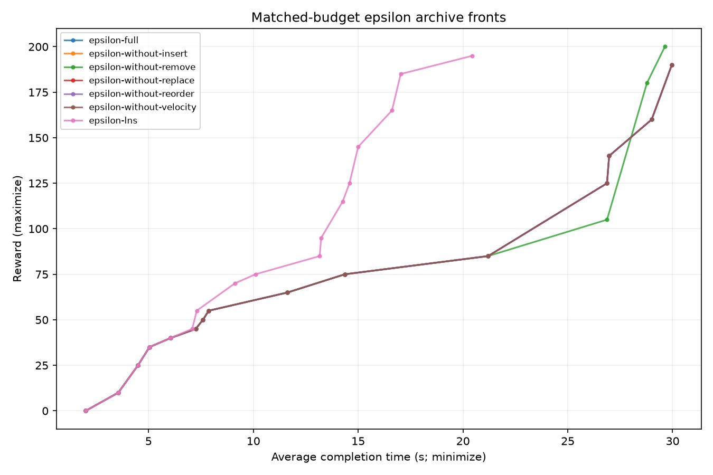
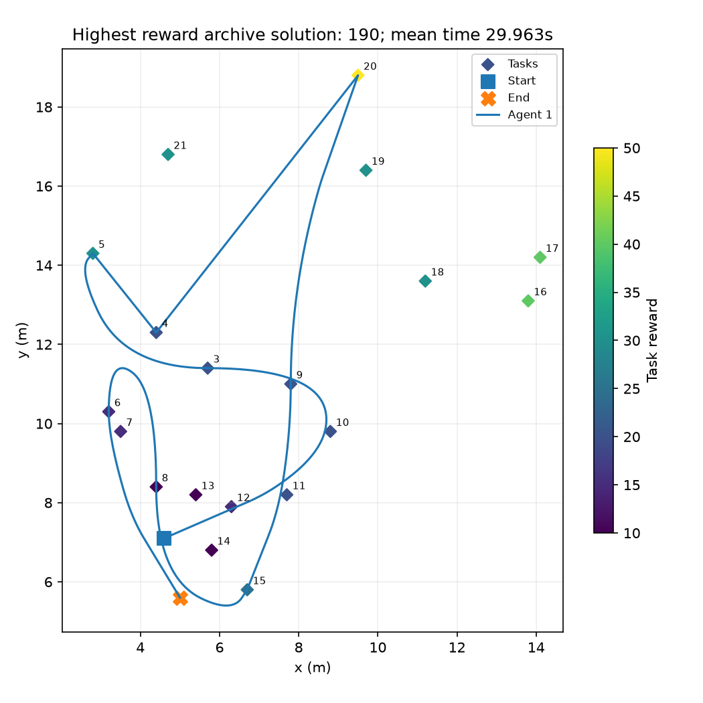
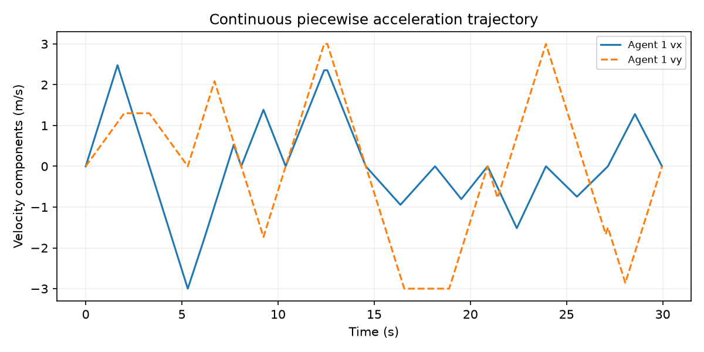

# Step 2 experimental validation

This is a small engineering campaign on all 19 tasks from Tsiligirides OP set 2, adapted to acceleration-aware motion. It is not a statistical comparison or a published-KOP reproduction. See [benchmark provenance](../benchmarks/tsiligirides/README.md).

Each search is limited to 45 seconds and 4,000 evaluations (whichever occurs first); each optimizer subprocess has a hard 120-second timeout. Waiting counts before arrival; zero endpoint velocity; componentwise speed/acceleration bounds. Collision and communication constraints are absent. Four headings and speed fractions 0/0.5/1 are used.

The user requested epsilon dominance after three initial starts. Those crowding runs are retained as superseded exploratory artifacts; one was terminated. All starts, including termination, count toward the ten-run cap. Final comparisons use only epsilon-policy outputs.

| Variant | Policy/status | Evaluations | Wall seconds | Front size | Best reward | Hypervolume |
|---|---|---:|---:|---:|---:|---:|
| full-seed42 | superseded crowding | 3715 | 45.225 | 15 | 190 | 1972.450 |
| without-insert | superseded crowding | 1 | 0.181 | 1 | 0 | 0.000 |
| without-remove | superseded crowding/terminated_on_user_steering | — | — | — | — | — |
| epsilon-full | epsilon | 3462 | 45.207 | 15 | 190 | 1972.450 |
| epsilon-without-insert | epsilon | 1 | 0.200 | 1 | 0 | 0.000 |
| epsilon-without-remove | epsilon | 3264 | 45.228 | 14 | 200 | 1942.627 |
| epsilon-without-replace | epsilon | 3332 | 45.232 | 15 | 190 | 1972.450 |
| epsilon-without-reorder | epsilon | 3329 | 45.235 | 15 | 190 | 1972.450 |
| epsilon-without-velocity | epsilon | 3232 | 45.234 | 15 | 190 | 1972.450 |
| epsilon-lns | epsilon | 4000 | 45.255 | 17 | 195 | 3498.338 |

Hypervolume uses the same minimization reference point `(0,30)` for `(-reward,time)`, with no normalization. It is descriptive for this instance and protocol. Epsilon outputs are approximate nondominated archive representatives.

Independent saved-output validation checks all trajectory pieces algebraically: position/velocity continuity, elapsed-time continuity, acceleration and velocity bounds over complete pieces, stopped final states, budgets, quadratic task passage, reward union, first-visitor attribution, objective values, and strict nondominance. Plot sampling is for display, not feasibility verification. Validation counts/residuals are in [the run ledger](../results/step2/ledger.json).

Removing insertion from direct initialization prevents any reward-bearing visit from entering the search; that ablation tests the whole implemented pipeline, including construction, rather than a pre-seeded neighborhood-only experiment. The LNS baseline is independently implemented and adapted to two objectives, not the source authors’ code. Practical wall stops may produce unequal evaluation counts. No superiority claim follows from one seed.

Reproduce setup and data conversion:

```sh
uv venv --python 3.12 .venv
uv pip install --python .venv/bin/python -e '.[test]'
.venv/bin/python scripts/prepare_benchmark.py
.venv/bin/python -m pytest -q
```

A single final run is reproducible with `topcc --instance benchmarks/tsiligirides/single-30s.json --mode single_kop --seed 42 --max-seconds 45 --max-evaluations 4000 --max-iterations 60 --eps-reward 1 --eps-time 0.1 --output /tmp/single-reproduction.json`. Add `--disable FAMILY` for an ablation or `--algorithm lns` for the baseline. These commands are documentation and were not additional campaign runs.

The committed ledger prevents accidental reruns beyond the cap. To regenerate figures/report without new searches, run `scripts/summarize_step2.py` and call `topcc.viz.plot_result` on a saved JSON file. The campaign script documents its original schedule and resumed epsilon revision.






